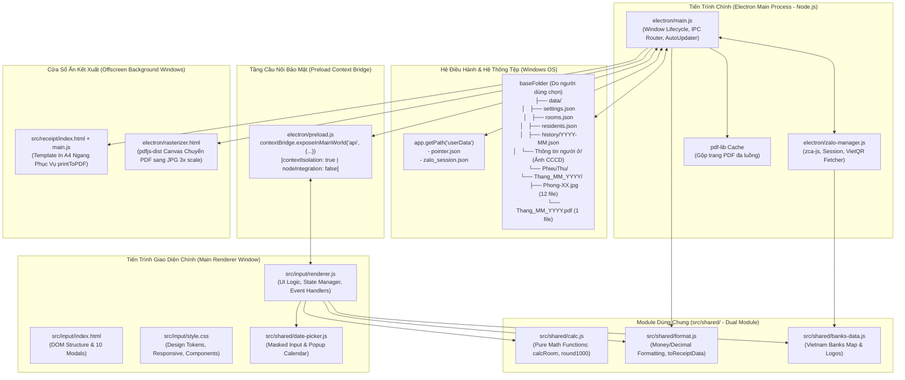
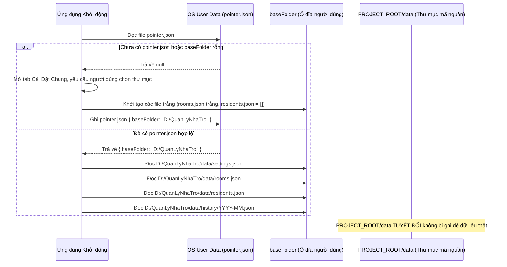
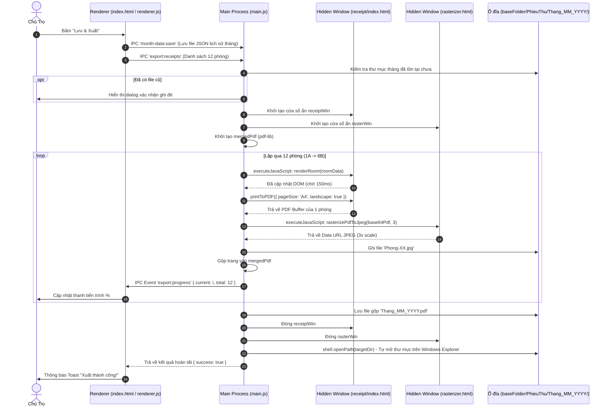
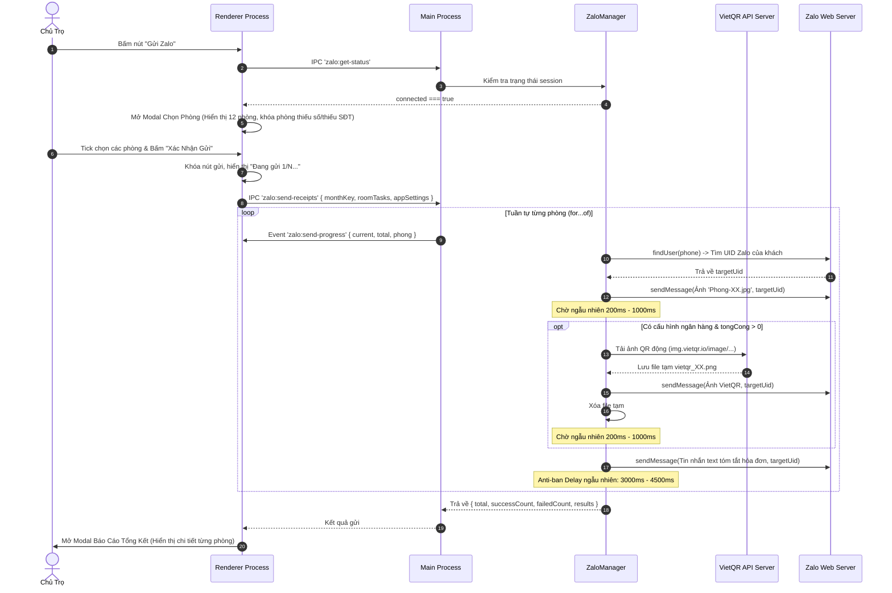

# 🏛️ Kiến Trúc Hệ Thống (System Architecture)

> **Tài liệu tham khảo thuộc Bộ Tri Thức Dự Án (Project Knowledge Base)**  
> **Ứng dụng:** Quản Lý Phòng Trọ (v3.0.1)  
> **Kiến trúc cốt lõi:** Multi-process Electron Architecture + Vanilla Frontend + Local JSON Storage + IPC Bridge

---

## 1. Kiến Trúc Tổng Thể (Overall System Architecture)

Ứng dụng được xây dựng theo mô hình kiến trúc đa tiến trình chuẩn của Electron nhằm đảm bảo tính bảo mật, hiệu năng cao và phân tách rõ ràng giữa tầng hệ thống (OS/Node.js) và tầng hiển thị (DOM/UI).



---

## 2. Chi Tiết Các Tầng & Trách Nhiệm Từng Thành Phần

### 2.1. Tiến trình chính (Main Process — `electron/main.js`)
- **Vai trò**: Đóng vai trò là "Backend" của ứng dụng, trực tiếp tương tác với hệ điều hành Windows, File System (`fs`), Dialog native và các thư viện C++ native (`sharp`).
- **Nhiệm vụ chính**:
  1. Quản lý vòng đời ứng dụng (`app.whenReady`, `window-all-closed`).
  2. Tạo và điều phối cửa sổ chính `BrowserWindow` với cấu hình an toàn:
     - `contextIsolation: true`: Cách ly hoàn toàn mã JavaScript của Renderer khỏi môi trường Node.js.
     - `nodeIntegration: false`: Chặn mã Renderer gọi trực tiếp các API nguy hiểm như `require`, `process`, `fs`.
  3. Quản lý file con trỏ `pointer.json` và di chuyển dữ liệu khi người dùng chọn thư mục mới trong `settings:save`.
  4. Đăng ký tất cả các IPC Handlers (`ipcMain.handle`) phục vụ:
     - Đọc/ghi file JSON cài đặt, phòng, cư dân, lịch sử tháng.
     - Chọn thư mục, chọn ảnh CCCD native dialog.
     - Lưu trữ, di chuyển và xóa thư mục ảnh CCCD.
     - Tự động kiểm tra và tải bản cập nhật qua `autoUpdater`.
  5. Điều phối quy trình xuất phiếu thu:
     - Khởi tạo 2 cửa sổ ẩn: `receiptWin` và `rasterWin`.
     - Lần lượt nạp dữ liệu từng phòng vào `receiptWin`, xuất buffer PDF qua `webContents.printToPDF`.
     - Đẩy buffer PDF sang `rasterWin` để chuyển đổi sang buffer JPEG bằng `pdfjs-dist`.
     - Ghi 12 file ảnh `.jpg` ra đĩa và gộp 12 trang PDF thành 1 file tổng duy nhất bằng `pdf-lib`.
     - Tự động đóng 2 cửa sổ ẩn và gọi `shell.openPath` mở thư mục kết quả.

### 2.2. Tầng Cầu Nối Bảo Mật (Preload Script — `electron/preload.js`)
- **Vai trò**: Cung cấp API có kiểm soát cho Renderer Process thông qua `window.api`.
- **Nguyên tắc thiết kế**:
  - Renderer không có quyền truy cập Node.js trực tiếp.
  - Mọi yêu cầu truy xuất tệp, mở dialog, gửi tin nhắn đều phải gọi hàm thông qua `window.api.<method>()`.
  - Toàn bộ kênh giao tiếp hai chiều (IPC Listeners) đều tự động dọn dẹp các listener cũ (`removeAllListeners`) trước khi gắn callback mới nhằm ngăn chặn triệt để rò rỉ bộ nhớ (Memory Leak).

### 2.3. Quản Lý Zalo Backend (Zalo Manager — `electron/zalo-manager.js`)
- **Vai trò**: Quản lý phiên làm việc, giao thức WebSocket và HTTP tới máy chủ Zalo thông qua thư viện `zca-js`.
- **Nhiệm vụ chính**:
  1. Khởi tạo phiên quét mã QR thời gian thực (`startQrLogin`), stream các sự kiện (`qr_generated`, `qr_scanned`, `qr_expired`, `confirming`, `success`) về Renderer.
  2. Lưu trữ an toàn thông tin phiên đăng nhập (`cookies`, `imei`, `userAgent`) vào `userData/zalo_session.json` và sao lưu tại `<baseFolder>/data/zalo_session.json`.
  3. Tự động khôi phục phiên (Silent Session Restore) ngầm khi ứng dụng khởi động.
  4. Quản lý tác vụ gửi hóa đơn hàng loạt (`sendReceipts`):
     - Lặp tuần tự qua các phòng được chọn (`for...of`), tuyệt đối không gửi song song.
     - Chèn độ trễ ngẫu nhiên (Anti-ban Random Delay: 3.0s – 4.5s) giữa các phòng.
     - Tự động tra cứu UID Zalo của người nhận từ Số điện thoại bằng `findUser(phone)`.
     - Tải mã thanh toán VietQR động từ dịch vụ VietQR API và gửi ảnh kèm tin nhắn chi tiết.
     - Timeout bảo vệ 15 giây độc lập cho từng phòng.

### 2.4. Tiến trình giao diện chính (Main Renderer — `src/input/`)
- **`index.html`**: Chứa toàn bộ cấu trúc giao diện 3 tab (`#section-data`, `#section-settings`, `#section-residents`) và 10 modal xác nhận/tương tác.
- **`style.css`**: Hệ thống CSS Design System hoàn chỉnh, hỗ trợ tùy biến CSS variables, responsive từ màn hình lớn 1400px đến tablet/mobile, custom scrollbar và hiệu ứng chuyển cảnh mượt mà.
- **`renderer.js`**: "Não bộ" của giao diện:
  - Quản lý trạng thái ứng dụng cục bộ (`roomsData`, `residentsList`, `roomsList`, `appSettings`, `selectedZaloRooms`).
  - Lắng nghe thay đổi bàn phím kiểu Excel (Enter xuống ô dưới, Shift+Enter lên ô trên, Tab sang ô bên cạnh).
  - Kích hoạt tính toán thời gian thực ngay khi gõ chỉ số.
  - Quản lý điều kiện bật các modal xác nhận (quay vòng công tơ, biến động $\ge 40\%$, cảnh báo cài đặt chưa lưu).
  - Thao tác CRUD danh sách người thuê và lọc tìm kiếm tức thì.

### 2.5. Tầng Template Phiếu Thu & Kết Xuất (Receipt Engine — `src/receipt/` & `electron/rasterizer.html`)
- **`src/receipt/index.html` + `style.css` + `main.js`**:
  - Được thiết kế chuẩn kích thước tờ in **A4 khổ ngang (297mm x 210mm)** với font chữ Times New Roman.
  - Sử dụng các chấm lấp đầy (`row-fill`) giả lập mẫu phiếu thu in truyền thống.
  - Hàm `renderRoom(data)` nhận dữ liệu đã định dạng và cập nhật các thẻ `<span>` tương ứng trong DOM.
- **`electron/rasterizer.html`**:
  - Chứa thư viện `pdfjs-dist` bản offline (`electron/vendor/pdfjs/`).
  - Hàm `window.rasterizePdfToJpeg(base64Pdf, 3)` nạp tài liệu PDF từ bộ nhớ, render lên thẻ `<canvas>` ẩn với tỉ lệ phóng đại **3x (DPI cao)** và trích xuất thành chuỗi Data URL `image/jpeg` chất lượng 92%.

### 2.6. Thư Viện Dùng Chung (Shared Utilities — `src/shared/`)
- Áp dụng kỹ thuật **Dual Module Export Pattern**:
  ```javascript
  if (typeof module !== 'undefined' && module.exports) {
    module.exports = { ... }; // Dành cho Node.js / Electron Main Process
  }
  if (typeof window !== 'undefined') {
    window.foo = foo;         // Dành cho Trình duyệt / Renderer Process
  }
  ```
- **`calc.js`**: Toàn bộ công thức tính toán toán học thuần túy (Pure Functions). Tuyệt đối không đụng tới DOM và không import Electron.
- **`format.js`**: Định dạng tiền tệ VNĐ (`2.200.000 đ`), số thập phân (`5,4`), ngày tháng và ánh xạ dữ liệu đầu vào cho phiếu thu (`toReceiptData`).
- **`date-picker.js`**: Bộ điều khiển ô nhập ngày tháng định dạng mặt nạ (`dd/mm/yyyy`) kèm lịch chọn Popup tùy chỉnh, độc lập hoàn toàn, không phụ thuộc jQuery hay Flatpickr.
- **`banks-data.js`**: Danh mục toàn bộ hơn 50 ngân hàng tại Việt Nam kèm mã BIN Napas, mã nhận diện, tên viết tắt và link logo chính thức.

---

## 3. Kiến Trúc Lưu Trữ Dữ Liệu & Cơ Chế Con Trỏ (Pointer Mechanism)

Một trong những thiết kế quan trọng nhất của dự án là **không bao giờ lưu dữ liệu cứng trong thư mục mã nguồn**.



### Quy tắc lưu trữ an toàn:
1. `app.getPath('userData')`: Nơi lưu trữ cấu hình môi trường máy tính của Electron:
   - `pointer.json`: Lưu con trỏ tới thư mục làm việc thực tế của người dùng.
   - `zalo_session.json`: Lưu thông tin xác thực phiên làm việc Zalo.
2. `<baseFolder>`: Thư mục độc lập do người dùng chỉ định (ví dụ `D:\QuanLyNhaTro` hoặc `C:\Users\Admin\Documents\NhaTro`):
   - Chứa toàn bộ dữ liệu lịch sử và phiếu thu.
   - Khi cài lại Windows hoặc nâng cấp bản cài mới, chỉ cần trỏ lại vào thư mục này là toàn bộ số liệu được giữ nguyên vẹn.

---

## 4. Luồng Dữ Liệu Chi Tiết Giữa Các Phân Hệ

### 4.1. Luồng Xuất Phiếu Thu (Export Receipt Flow)



### 4.2. Luồng Gửi Hóa Đơn Qua Zalo (Zalo Send Flow)



---

## 5. Các Ràng Buộc & Nguyên Tắc Kiến Trúc Bất Di Bất Dịch

1. **Không sử dụng Frontend Framework**:
   - Kiến trúc ứng dụng được tối ưu xoay quanh DOM API nguyên bản của JavaScript.
   - Không đưa React, Vue, Angular, Svelte hay Tailwind CSS vào dự án nhằm đảm bảo không phát sinh bước compile/bundling phức tạp và duy trì tính ổn định vĩnh viễn.
2. **Không sử dụng Server Database**:
   - Giữ nguyên cấu trúc lưu trữ file JSON cục bộ (`pointer.json`, `settings.json`, `rooms.json`, `residents.json`, `history/YYYY-MM.json`).
3. **Bảo tồn tính toàn vẹn của Module Tính Toán (`src/shared/calc.js`)**:
   - `calc.js` là Pure Function không phụ thuộc môi trường. Mọi thay đổi logic tính toán phải được kiểm thử độc lập bằng Node.js trước khi áp dụng vào giao diện.
4. **Bảo vệ tài khoản Zalo chủ trọ**:
   - Mọi hoạt động gửi tin nhắn tự động phải tuân thủ nghiêm ngặt: Gửi tuần tự (`for...of`), độ trễ ngẫu nhiên từ 3.0s đến 4.5s, timeout 15s cho mỗi phòng để tránh bị Zalo đánh dấu là hành vi spam (Anti-Spam / Anti-Ban).

