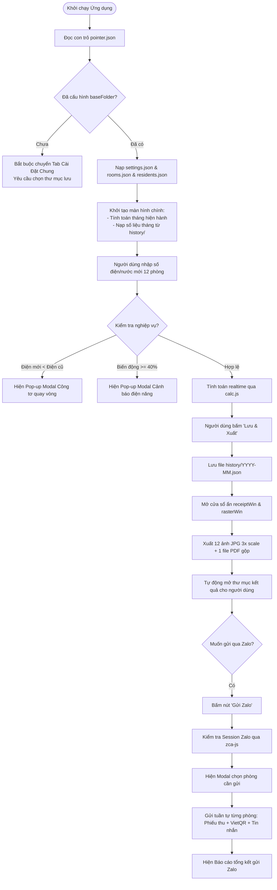

# 📖 Tổng Quan Dự Án Quản Lý Phòng Trọ (Project Overview)

> **Tài liệu tham khảo thuộc Bộ Tri Thức Dự Án (Project Knowledge Base)**  
> **Phiên bản hiện tại:** 3.0.1  
> **Nền tảng:** Electron Desktop Application (Windows 10/11)  
> **Tác giả:** Lê Công Bá Nhân  
> **Mục tiêu:** Quản lý số liệu, tự động tính toán điện nước, xuất hóa đơn ảnh/PDF, quản lý người ở & CCCD, gửi phiếu thu tự động qua Zalo.

---

## 1. Bài Toán Nghiệp Vụ & Vấn Đề Cần Giải Quyết

Trong quản lý nhà trọ truyền thống, chủ trọ thường đối mặt với các khó khăn:
1. **Tính toán thủ công dễ sai sót**: Số điện, số nước, điện hao tải (tổn thất đường dây), tiền rác, internet cộng gộp nhiều khoản nhỏ, việc nhân chia và làm tròn hàng nghìn trên giấy hoặc Excel dễ gây nhầm lẫn và thiếu minh bạch với người thuê.
2. **Sự cố công tơ điện quay vòng (Rollover)**: Đồng hồ điện cơ học hoặc điện tử 4-5 chữ số khi chạm ngưỡng tối đa (thường là 10.000 kWh) sẽ tự động quay về `0000`. Khi nhập chỉ số mới nhỏ hơn cũ, công thức thông thường `Mới - Cũ` sẽ cho ra số âm hoặc gây hoang mang nếu không xử lý tự động.
3. **Biến động bất thường không được phát hiện kịp thời**: Rò rỉ nước ngầm, chập điện hoặc người thuê sử dụng thiết bị công suất cao đột biến (tăng/giảm $\ge 40\%$) thường chỉ được phát hiện khi có khiếu nại.
4. **Mất nhiều thời gian xuất phiếu thu**: Phải viết tay từng phiếu hoặc copy/paste trong Excel rồi in ấn, chụp hình gửi cho từng phòng rất tốn công.
5. **Quản lý thông tin cư dân và hình ảnh CCCD lộn xộn**: Thông tin khách thuê, số điện thoại, ngày vào ở, ảnh chụp mặt trước và mặt sau CCCD/CMND bị rải rác trên Zalo, điện thoại, dễ thất lạc và khó tra cứu khi công an phường yêu cầu kiểm tra tạm trú.
6. **Bất tiện khi thu tiền và đối chiếu**: Chủ trọ phải nhắn tin từng người, gửi số tài khoản, người thuê chuyển khoản không đúng nội dung dẫn đến khó kiểm soát.

Ứng dụng **Quản Lý Phòng Trọ** được phát triển nhằm giải quyết trọn vẹn toàn bộ các khó khăn trên trong một giao diện desktop thống nhất, đơn giản, hiện đại và hoạt động ngoại tuyến (offline-first).

---

## 2. Đối Tượng Sử Dụng & Phạm Vi Áp Dụng

- **Đối tượng người dùng chính**: Chủ nhà trọ, quản lý tòa nhà căn hộ dịch vụ mini, người trực tiếp ghi số điện nước hàng tháng và thu tiền trọ.
- **Đặc điểm người dùng**: Cần giao diện trực quan, cỡ chữ to rõ ràng, độ tương phản cao, thao tác bàn phím nhanh như Excel, hạn chế tối đa các thao tác chuột phức tạp.
- **Quy mô hệ thống**:
  - Cố định **12 phòng trọ** phân bổ thành 2 dãy: Dãy A (`1A`, `2A`, `3A`, `4A`, `5A`, `6A`) và Dãy B (`1B`, `2B`, `3B`, `4B`, `5B`, `6B`).
  - Quản lý theo từng tháng chu kỳ (bắt đầu từ mốc lịch sử `2026-07`).
  - Hỗ trợ lưu trữ không giới hạn hồ sơ cư dân và hình ảnh CCCD kèm theo.

---

## 3. Mục Tiêu Thiết Kế & Định Hướng Kỹ Thuật

1. **Offline-first & Lưu trữ cục bộ an toàn**:
   - 100% dữ liệu được lưu dưới dạng file JSON cục bộ trên máy người dùng.
   - Tuyệt đối không phụ thuộc vào máy chủ cơ sở dữ liệu bên ngoài (không dùng MySQL, PostgreSQL, MongoDB, Firebase hay Supabase).
2. **Cơ chế thư mục động (Dynamic Folder via Pointer)**:
   - Dữ liệu người dùng (`data/`) và thư mục ảnh/PDF phiếu thu (`PhieuThu/`) nằm trong một thư mục do người dùng tự chọn (`baseFolder`), được trỏ tới bởi file `pointer.json` đặt trong `app.getPath('userData')`.
   - Giúp người dùng dễ dàng sao lưu lên Google Drive, OneDrive, USB hoặc chuyển máy mà không lo mất dữ liệu.
3. **Phân tách tuyệt đối 2 vùng dữ liệu (Data Isolation)**:
   - Thư mục mã nguồn ứng dụng (App Bundle) chỉ chứa khung code và template trắng (Seed data).
   - Vùng dữ liệu người dùng (User Runtime Data) là nơi duy nhất lưu trữ thông tin thực tế. Khi cập nhật phiên bản (Auto Update), dữ liệu của người dùng được bảo toàn nguyên vẹn 100%.
4. **Tối giản công nghệ (Vanilla Stack)**:
   - Sử dụng HTML5, CSS3 và JavaScript thuần (ES6+).
   - Không dùng framework nặng (React, Vue, Angular), không dùng bundler phức tạp (Webpack, Vite), giúp ứng dụng khởi động cực nhanh, dung lượng nhẹ và dễ bảo trì lâu dài.
5. **Tự động hóa thông minh (Smart Automation)**:
   - Tự động phát hiện công tơ quay vòng và biến động điện $\ge 40\%$.
   - Tự động kế thừa chỉ số mới tháng trước sang chỉ số cũ tháng sau.
   - Tự động kết xuất hàng loạt 12 ảnh phiếu thu JPG (3x scale) + 1 file PDF gộp chỉ với 1 cú click.
   - Tự động tạo ảnh VietQR có sẵn số tiền và nội dung chuyển khoản chuẩn.
   - Tự động gửi phiếu thu qua Zalo với cơ chế chống spam (anti-ban random delay).
   - Tự động kiểm tra và cài đặt bản cập nhật ngầm qua GitHub Releases.

---

## 4. Tổng Quan Các Công Nghệ Cốt Lõi

| Thành phần | Công nghệ / Thư viện | Vai trò trong hệ thống |
|---|---|---|
| **Nền tảng Desktop** | Electron (`v43.2.0`) | Khung ứng dụng desktop đa tiến trình, quản lý vòng đời và cửa sổ |
| **Giao diện Người dùng** | HTML5, CSS3, Vanilla JS | Giao diện nhập liệu, cài đặt, quản lý người ở và các modal |
| **Bảo mật giao tiếp** | Electron `contextBridge` | Cách ly an toàn giữa tiến trình chính (Main) và tiến trình hiển thị (Renderer) |
| **Xử lý PDF** | `pdf-lib` (`v1.17.1`) | Gộp các trang PDF đơn lẻ thành 1 tài liệu PDF hoàn chỉnh |
| **Kết xuất PDF sang ảnh** | `pdfjs-dist` (`v3.11.174`) | Chuyển đổi trang PDF của phiếu thu sang ảnh JPEG độ nét cao (3x scale) |
| **Xử lý ảnh & Metadata** | `sharp` (`v0.35.4`) | Trích xuất kích thước và metadata ảnh phục vụ thư viện Zalo |
| **Tích hợp Zalo** | `zca-js` (`v2.1.2`) | Xác thực quét mã QR Zalo, duy trì session và gửi tin nhắn/ảnh tự động |
| **Đóng gói & Cài đặt** | `electron-builder` (`v25.1.8`) | Đóng gói bộ cài đặt Windows NSIS (`.exe`) |
| **Tự động Cập nhật** | `electron-updater` (`v6.8.9`) | Kiểm tra, tải và cài đặt bản mới tự động từ GitHub Releases |

---

## 5. Vòng Đời Hoạt Động Của Ứng Dụng (End-to-End Workflow)

---

## 6. Các Phân Hệ Chính Trong Ứng Dụng

Ứng dụng được chia thành 3 phân hệ chức năng tương ứng với 3 Tab trên thanh điều hướng chính:

### 1. Phần 1: Nhập Dữ Liệu (`#section-data`)
- **Bảng chỉ số 12 phòng**: Hiển thị bảng tính dạng Excel gồm 16 cột. Cột chỉ số cũ được khóa tự động kế thừa từ tháng trước; người dùng chỉ cần nhập chỉ số mới.
- **Thống kê tổng quan (Stats Grid)**: 4 thẻ thống kê trực quan cập nhật theo thời gian thực: Doanh Thu Tháng Này, Tổng Điện Tiêu Thụ, Tổng Nước Tiêu Thụ, Số Phòng Đã Nhập.
- **Thao tác nhanh**: Chọn Tháng/Năm, Nút "Gửi Zalo" và Nút "Lưu & Xuất".

### 2. Phần 2: Cài Đặt Chung (`#section-settings`)
- **Quản lý Thư mục lưu trữ**: Chọn thư mục gốc `baseFolder` để lưu dữ liệu và phiếu thu.
- **Cấu hình Đơn giá hệ thống**: Giá phòng mặc định, giá điện, giá nước, tiền rác, tiền internet, tỷ lệ hao tải điện (%), số điện thoại chủ trọ.
- **Thông tin Tài khoản Ngân hàng**: Tùy chọn ngân hàng Việt Nam (có logo), số tài khoản, tên chủ tài khoản phục vụ tạo mã VietQR.
- **Tài khoản Zalo**: Đăng nhập quét mã QR, xem Avatar và Tên tài khoản, Đổi tài khoản, Đăng xuất.
- **Cấu hình Bật/Tắt Pop-up Cảnh báo**: Công tắc Toggle switch cho phép bật/tắt cảnh báo quay vòng và biến động điện $\ge 40\%$.
- **Thông tin Phiên bản & Kiểm tra Cập nhật**: Hiển thị phiên bản hiện hành, nút kiểm tra bản mới thủ công từ GitHub Releases.

### 3. Phần 3: Quản Lý Phòng & Người Ở (`#section-residents`)
- **Tổng quan Phòng trọ**: 12 thẻ phòng trực quan thể hiện trạng thái "Đang ở" hoặc "Phòng trống", tên chủ phòng và số lượng thành viên.
- **Phân bổ phòng (Room Detail Modal)**: Gán người đại diện (chủ phòng) và chọn các thành viên cùng phòng từ danh sách người thuê.
- **Danh sách Cư dân (Residents Table)**: Quản lý chi tiết toàn bộ người thuê trọ (Họ tên, CCCD, SĐT liên hệ, SĐT Zalo, Ngày sinh, Ngày vào ở, Phòng đang ở, Trạng thái ảnh CCCD).
- **Hồ sơ CCCD**: Upload, lưu trữ và xem phóng to (Lightbox) ảnh chụp mặt trước và mặt sau CCCD của từng người thuê.

